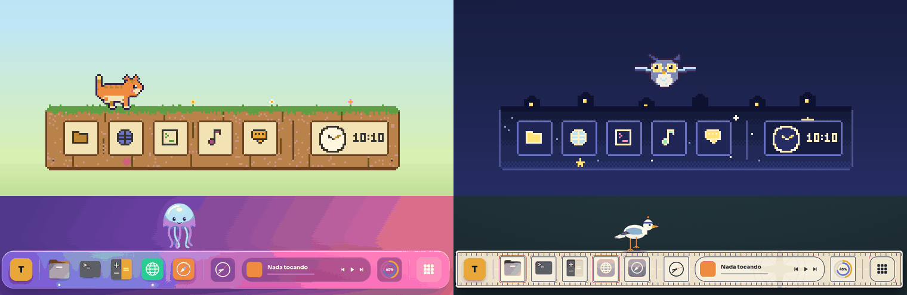
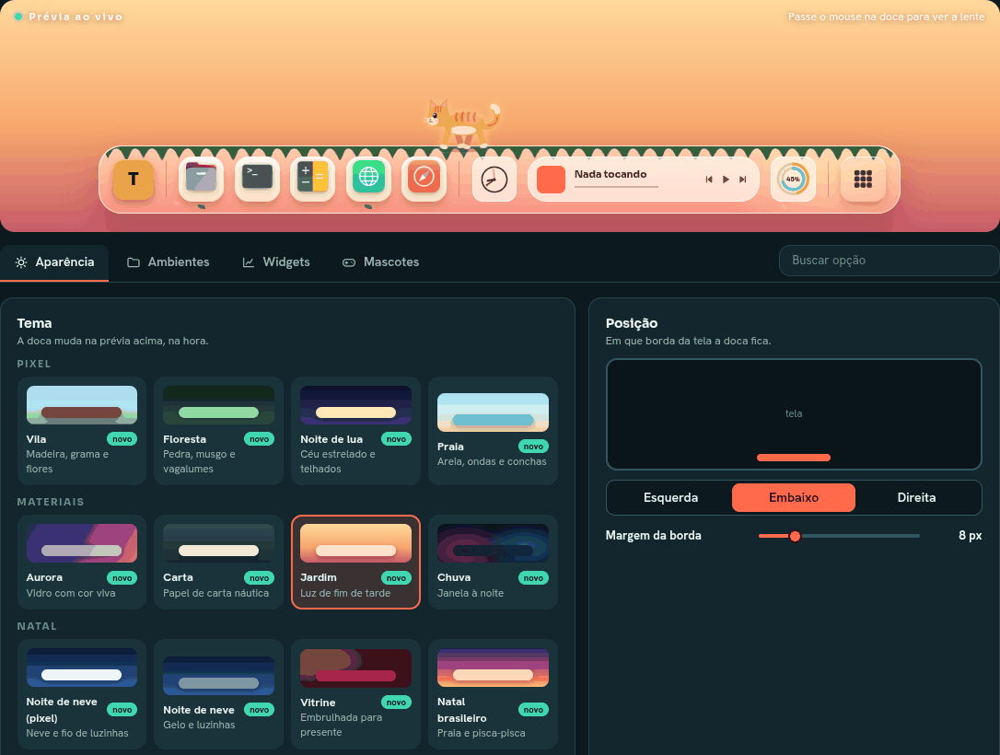
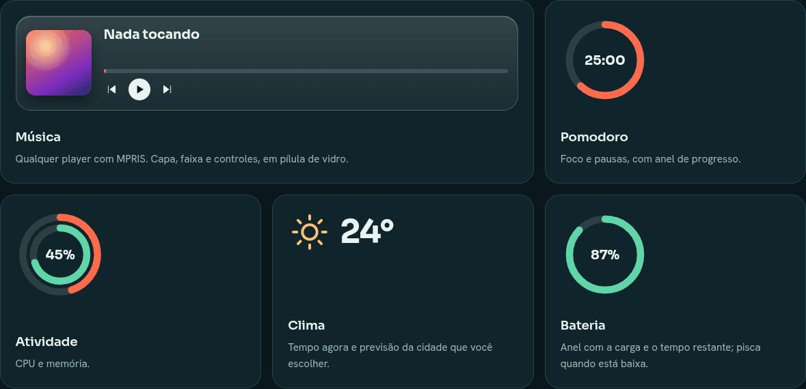

<div align="center">


# A·T·L·A·S

**A**mbientes, **T**arefas, **L**ançadores, **A**plicativos e **S**istema

Dock com lente de ampliação, ambientes, widgets e mascotes para o GNOME Shell (Wayland e X11).

[Site](https://atlas.joaovitorsantos.com.br/) · [Changelog](CHANGELOG.md) · [Licença GPL-3.0](LICENSE)



</div>

## Sumário
- [O que é](#o-que-é)
- [Recursos](#recursos)
- [Compatibilidade](#compatibilidade)
- [Instalação](#instalação)
- [Configuração](#configuração)
- [Atalhos](#atalhos)
- [Temas](#temas)
- [Widgets](#widgets)
- [Mascotes](#mascotes)
- [Privacidade e rede](#privacidade-e-rede)
- [Desempenho](#desempenho)
- [Solução de problemas](#solução-de-problemas)
- [Desenvolvimento](#desenvolvimento)
- [Próximos passos](#próximos-passos)
- [Licença](#licença)

## O que é
ATLAS é uma extensão do GNOME Shell que troca o dock padrão por uma dock com lente de ampliação. Além dos apps, ela organiza o dia a dia em **ambientes** (conjuntos de apps com nome, cor e tema próprios), mostra **widgets** desenhados na própria dock (relógio, Pomodoro, clima, música, uso de CPU e outros) e tem **mascotes** que aparecem em horas, datas e eventos do sistema.

Tudo é configurado por um app próprio (janela "Palco", com prévia ao vivo da dock) e as opções são GSettings, então a dock reage na hora a qualquer mudança.

## Recursos

**Dock**
- Favoritos do GNOME mais apps abertos (separados por uma linha) e botão de grade de apps
- Lente de ampliação suave, indicador de app aberto (ponto, barra ou nenhum), tooltip com o nome
- Clique ativa ou abre o app; botão do meio ou Ctrl+clique abre nova janela
- Menu de clique direito nos ícones: ações do app, nova janela, fixar ou desafixar, fechar janelas. No vidro da dock ou no seletor de ambientes: menu geral com Configurações
- Prévia de janelas: miniaturas ao vivo ao parar o mouse num app aberto (clique traz a janela, X ou clique do meio fecha)

- Posição embaixo, à esquerda ou à direita, com margem; opção de reservar espaço na tela
- Auto-ocultar (uma zona de 2 px na borda traz a dock de volta)
- Telas: cada tela tem o próprio interruptor (uma, várias ou nenhuma) e o próprio auto-ocultar
- Esconde sozinha no Overview e em tela cheia
- Efeito ao passar o mouse (brilho ou ícone que sobe) e animação de abertura (deslizar ou surgir)
- Ícone do ATLAS no painel superior, com menu de ambientes, temas, auto-ocultar e Configurações (pode ser ocultado)

**Ambientes**
- Conjuntos de apps com nome, cor e tema, criados no app de configuração
- Seletor redondo na dock, roda do mouse sobre a dock e atalhos de teclado trocam de ambiente (cada forma pode ser desligada)
- Coleções: um ícone com mosaico que guarda um grupo de apps e abre a lista ao clicar
- Não perturbe: um ambiente pode entrar sozinho quando o Não perturbe do GNOME liga, e voltar ao anterior ao desligar
- Janelas seguem o ambiente (opcional, desligado por padrão): ao trocar, minimiza as janelas dos apps de outros ambientes e as traz de volta ao retornar
- Cada ambiente tem seus próprios apps, tema e widgets

**Widgets e mascotes**
- 14 widgets desenhados com Cairo (anéis, gráficos, relógio de ponteiros), com painel rico ao clicar e, em alguns, versão larga
- 13 mascotes (hora, datas, eventos do sistema e clima), todos desligados por padrão

**App de configuração**
- Janela com prévia ao vivo da dock sobre o seu papel de parede, abas Aparência, Ambientes, Widgets e Mascotes, busca de opções e botão de restaurar padrões

## Compatibilidade

| Sistema | GNOME Shell | Situação |
|---|---|---|
| Ubuntu 24.04 LTS | 46 | **Testado** (uso diário) |
| Ubuntu 24.10, 25.04, 25.10, 26.04 | 47 a 50 | **Ainda não declarado.** As APIs usadas foram conferidas no código do GNOME Shell e do mutter e devem existir, mas falta testar em sessão real. O suporte entra no `metadata.json` depois do teste |
| Fedora, Debian 13, Arch, openSUSE (com GNOME 47 ou mais novo) | 47 a 50 | Mesmo caso. Com GNOME 46 (ex.: Fedora 40) deve funcionar como no Ubuntu 24.04, mas não foi testado |
| Ubuntu 22.04, Debian 12 | 42 e 43 | **Não suportado** (sem módulos ESM nem libadwaita 1.5) |
| KDE, XFCE, Cinnamon e outros desktops | — | **Não suportado**: a dock é uma extensão do GNOME Shell |

**Requisitos**
- GNOME Shell 46, sessão Wayland ou X11
- `gjs`, GTK 4 e libadwaita 1.5 ou mais nova (app de configuração; o app avisa se a versão for anterior)
- `libsoup3` (widget Clima) e UPower (widget Bateria)
- Para criar o zip a partir do código: `bash`, `zip`, `node` e `glib-compile-schemas` (pacote `libglib2.0-bin` no Ubuntu)

Se algo falhar na sua versão, abra uma issue com a saída de `journalctl -f -o cat /usr/bin/gnome-shell`.

## Instalação

### Pelo zip
```bash
git clone https://github.com/Joaovitor12j/atlas.git
cd atlas
./pack.sh                                                  # gera dist/atlas@joaovitor12j.dev.zip
gnome-extensions install --force dist/atlas@joaovitor12j.dev.zip
```
Faça logout e login (no Wayland o Shell só enxerga extensões novas depois disso) e ative:
```bash
gnome-extensions enable atlas@joaovitor12j.dev
gnome-extensions disable dash-to-dock@micxgx.gmail.com ubuntu-dock@ubuntu.com   # evita duas docks (Ubuntu)
```
O zip leva a extensão e o app de configuração (`app/`). O app abre pela engrenagem do app Extensões, pelo menu do painel ou pelo clique direito na dock.

`./pack.sh --ego` gera o zip sem o schema compilado, no formato do extensions.gnome.org.

### Para desenvolver (symlink)
```bash
./install.sh                                    # symlink em ~/.local/share/gnome-shell/extensions, compila o schema e cria o lançador do app
gnome-extensions enable atlas@joaovitor12j.dev  # após relogin (Wayland)
```
O `install.sh` também instala o ícone e um `.desktop` do app de configuração no menu de aplicativos.

### Desinstalar
```bash
gnome-extensions disable atlas@joaovitor12j.dev
gnome-extensions uninstall atlas@joaovitor12j.dev
```
Se instalou com o `install.sh`, remova também `~/.local/share/applications/dev.joaovitor12j.Atlas.desktop` e o ícone `dev.joaovitor12j.Atlas.svg` em `~/.local/share/icons/hicolor/scalable/apps/`.

## Configuração
O app de configuração abre de três formas:
- engrenagem do ATLAS no app Extensões (ou `gnome-extensions prefs atlas@joaovitor12j.dev`);
- menu do painel ou clique direito na dock, em **Configurações**;
- direto do código, sem relogin: `./prefs.sh` (aceita `--pagina=aparencia|ambientes|widgets|mascotes`).

<p align="center"></p>

Todas as opções são GSettings do schema `org.gnome.shell.extensions.atlas`, então também dá para mexer pelo terminal (a dock reage ao vivo):
```bash
./tema.sh noite                                   # troca o tema (ids na seção Temas)
gsettings --schemadir atlas@joaovitor12j.dev/schemas \
  set org.gnome.shell.extensions.atlas posicao left
```
Em uma instalação por zip, use `~/.local/share/gnome-shell/extensions/atlas@joaovitor12j.dev/schemas` como `--schemadir`.

## Atalhos
Os atalhos de ambiente são configuráveis no app (aba Ambientes) e cada forma de trocar pode ser desligada.

| Ação | Padrão |
|---|---|
| Ambiente seguinte | `Super+Alt+→` |
| Ambiente anterior | `Super+Alt+←` |
| Ir direto ao N-ésimo ambiente (1 a 9) | `Ctrl+Alt+1` a `Ctrl+Alt+9` |
| Trocar de ambiente com a roda | roda do mouse sobre a dock |

## Temas
Cada tema define material da dock, borda e sombra, indicador, tile de widget e efeito ambiente. Cada ambiente pode ter o seu. Os temas de pacote (Pixel, Materiais, Natal) são desenhados em Cairo a partir dos protótipos em [docs/design/pacotes-de-temas](docs/design/pacotes-de-temas).

| Pacote | Temas (id) |
|---|---|
| Clássico | Noite (`noite`, padrão), Papel (`papel`), Cristal (`cristal`, blur do fundo), Neon (`neon`), Oceano (`oceano`), Sakura (`sakura`), Ônix (`onix`) |
| Pixel | Vila (`vila`), Floresta (`floresta`), Noite de lua (`lua`), Praia (`praia`) |
| Materiais | Aurora (`aurora`), Carta (`carta`), Jardim (`jardim`), Chuva (`chuva`) |
| Natal | Noite de neve pixel (`nevepixel`), Noite de neve materiais (`nevemat`), Vitrine (`vitrine`), Natal brasileiro (`brasileiro`) |

## Widgets
Ficam por ambiente; ordem e posição (antes ou depois dos apps) se configuram na aba Widgets. Os marcados com ▭ têm versão larga.

| Widget | O que faz |
|---|---|
| Relógio ▭ | Ponteiros (ou digital na versão larga); o clique abre o calendário do mês |
| Pomodoro | Foco e pausas, com durações configuráveis |
| Bateria | Anel com a carga e o tempo restante (UPower); pisca quando está baixa |
| Música ▭ | Capa e controles de qualquer player MPRIS |
| Progresso do tempo | Quatro anéis: dia, semana, mês e ano |
| Cronômetro | Conta para cima, com voltas |
| Timer | Contagem regressiva |
| Atividade ▭ | Anéis de CPU e memória; a versão larga traz o gráfico dos últimos minutos |
| Rede ▭ | Download e upload com gráfico |
| Contagem regressiva | Dias que faltam para uma data |
| Área de transferência | Histórico do que você copiou (só texto) e itens fixados |
| Slack | Ícone do Slack com selo de mensagens não lidas; o clique abre o Slack |
| Clima ▭ | Open-Meteo: tempo agora, próximas 24 h e 5 dias, com a cidade escolhida por busca |
| Nota | Um recado fixo na dock, editável pelo clique |

<p align="center"></p>

Os widgets pausam com a dock escondida, no Overview e em tela cheia, e só redesenham quando algo muda.

## Mascotes
Todos vêm desligados. Cada um tem horários e limites configuráveis, um seletor de movimento (sortear ou fixar) e um botão **Testar agora**. Só aparecem na dock da tela principal e pulam a aparição com a dock escondida, no Overview e com o Não perturbe ligado. Detalhes em [docs/MASCOTES.md](docs/MASCOTES.md).

| Categoria | Mascotes |
|---|---|
| Hora do dia | **Cuco** (canta a hora), **Gato** (atravessa a dock), **Coruja** (de madrugada) |
| Datas e temas | **Papai Noel** e **Boneco de neve** (1 a 25 de dezembro), **Fantasma** e **Esqueleto** (24 a 31 de outubro) |
| Eventos do sistema | **Chama** (memória alta), **Pilha cansada** (bateria baixa), **Satélite perdido** (rede caiu), **Tomate** (fim de um foco do Pomodoro) |
| Clima | **Calor** e **Frio** (temperatura da cidade do widget Clima passa do limite) |

## Privacidade e rede
- Sem telemetria, sem conta e sem chaves.
- O widget **Clima** consulta a Open-Meteo (busca de cidade e previsão). Só as coordenadas da cidade escolhida saem da máquina.
- O widget **Área de transferência** lê o texto copiado. O histórico fica só na memória; apenas os itens que você fixa são salvos (GSettings).
- Os mascotes **Calor** e **Frio** usam a temperatura do widget Clima; os de evento só escutam sinais do sistema (UPower, rede, memória) enquanto estão ligados.
- O widget **Slack** lê só o tooltip do item de bandeja do Slack ("Nenhuma mensagem não lida" ou a contagem); não acessa mensagens nem a conta.

## Desempenho
O ATLAS é leve: cerca de **0,14% de um núcleo** em uso normal (**~0,03%** com a dock escondida, **zero** sem widgets) e **2 a 5 MB** de memória, dentro do `gnome-shell`. Os números, o método e o que ficou sem medir estão em [docs/DESEMPENHO.md](docs/DESEMPENHO.md). Há um medidor opt-in (chave `perfil-ativo`) para você conferir na sua máquina.

## Solução de problemas
| Sintoma | O que fazer |
|---|---|
| A extensão não aparece depois de instalar | No Wayland é preciso sair e entrar de novo na sessão |
| Duas docks na tela | `gnome-extensions disable dash-to-dock@micxgx.gmail.com ubuntu-dock@ubuntu.com` |
| O app de configuração não abre | Rode `gjs -m ~/.local/share/gnome-shell/extensions/atlas@joaovitor12j.dev/app/main.js` no terminal e veja o erro. Confira se a libadwaita é 1.5 ou mais nova |
| Erro de schema ao abrir o app | `glib-compile-schemas ~/.local/share/gnome-shell/extensions/atlas@joaovitor12j.dev/schemas` |
| Quer ver os logs | `journalctl -f -o cat /usr/bin/gnome-shell` (as mensagens têm o prefixo `[atlas]`) |
| Extensão com erro em outra versão do GNOME | Abra uma issue com os logs e a versão (`gnome-shell --version`) |

## Desenvolvimento
Estrutura (tudo em `atlas@joaovitor12j.dev/`):

| Arquivo | Papel |
|---|---|
| `extension.js` | Carregador de desenvolvimento (copia os módulos para `.run-<timestamp>/` a cada enable, para recarregar sem relogin) |
| `dock.js` | Classes `Dock` (enable/disable, ambientes, Não perturbe, menu do painel) e `DockView` (actors, lente, posição, auto-ocultar, prévia de janelas) |
| `widgets.js` | Base `Widget` e uma classe por widget |
| `mascotes.js` | Motor dos mascotes |
| `decoracao.js` | Vidro, tiles, indicadores e efeitos dos temas de pacote |
| `desenho.js` | Desenho Cairo puro (anéis, gráficos, relógio, mascotes) |
| `logica.js` | Lógica pura, testável com Node |
| `catalogo.js` | Listas de temas, widgets e mascotes compartilhadas com o app |
| `clima.js` | Previsão do tempo (Open-Meteo), dividida entre o widget Clima e os mascotes de frio e calor |
| `perf.js` | Medidor opt-in (`perfil-ativo`) e o `agendar()` usado pelos temporizadores |
| `eventos.js` | Avisos entre módulos (fim de foco do Pomodoro para o mascote do tomate) |
| `ponte.js`, `protocolo.js` | Cliente e contrato D-Bus do daemon do app nativo (fase 0, `app/daemon.js`) |
| `app/` | App de configuração (gjs + GTK4 + libadwaita), em processo próprio |
| `schemas/` | Schema GSettings `org.gnome.shell.extensions.atlas` |

O `extension.js` do repositório é só para desenvolvimento; o `pack.sh` o troca por `empacotar/extension.js` (import direto) dentro do zip.

Recarregar depois de editar qualquer módulo ou `temas.css`:
```bash
gnome-extensions disable atlas@joaovitor12j.dev && gnome-extensions enable atlas@joaovitor12j.dev
```
Mudanças em `extension.js` e `metadata.json` só valem depois de um novo login (Wayland).

Testes e verificações:
```bash
npm test                                                              # lógica pura e consistência de catálogo, schema e temas
glib-compile-schemas --strict --dry-run atlas@joaovitor12j.dev/schemas   # valida o schema
gjs -m tests/previa-cuco.js /tmp/cuco.png                             # prévia PNG de um desenho Cairo (tests/previa-*.js)
```
O CI (GitHub Actions) roda a checagem de sintaxe de cada módulo, o schema em modo estrito e os testes a cada PR.

Ao adicionar tema, widget, mascote ou chave de configuração, atualize todos os lados (o `tests/estrutura.test.js` confere): entrada no `catalogo.js`, `<choice>` ou `<key>` no schema, regras em `temas.css`, classe em `widgets.js`. Mais contexto em [CLAUDE.md](CLAUDE.md) e em [docs/](docs).

O código, os comentários e os commits são em português.

## Próximos passos
Prateleira de arquivos e calendário. O histórico de mudanças está no [CHANGELOG](CHANGELOG.md).

## Licença
GPL-3.0-or-later. Veja o arquivo [LICENSE](LICENSE).
